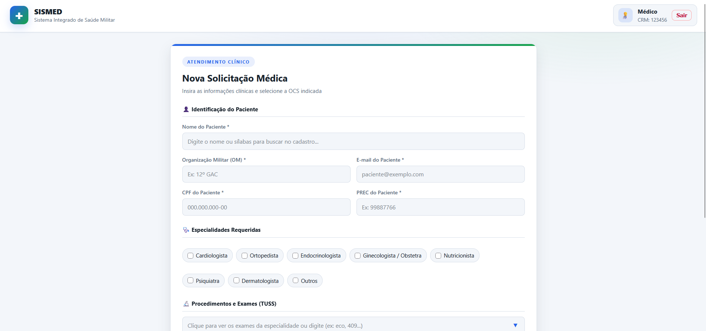

# Manual do Usuário — SISMED - Sistema Integrado de Saúde Militar

## Sumário

1. [O Médico e o Encaminhamento](#1-o-médico-e-o-encaminhamento)
2. [O Emissor de Guia](#2-o-emissor-de-guia)
3. [O Médico Chefe e o Chefe de Seção com as Assinaturas](#3-o-médico-chefe-e-o-chefe-de-seção-com-as-assinaturas)
4. [A OCS](#4-a-ocs)
5. [O Faturamento](#5-o-faturamento)
6. [A Lisura](#6-a-lisura)

---

## 1. O Médico e o Encaminhamento

Nesta etapa inicial do atendimento, o médico avalia o beneficiário e registra o encaminhamento que orienta os procedimentos ou solicitações seguintes.

* **Finalidade:** registrar a indicação clínica e os dados básicos do atendimento do beneficiário (como nome e PREC/CP) para embasar a emissão da guia e a conferência posterior dos itens.
* **O que observar:**
  * Confirmar a identificação correta do beneficiário e a data de atendimento.
  * Garantir clareza na descrição/indicação para evitar inconsistências nas próximas etapas.

  

---

## 2. O Emissor de Guia

A partir do encaminhamento, o emissor formaliza a guia vinculada ao beneficiário e à **OCS** (Organização Civil de Saúde).

* **Finalidade:** emitir a guia com identificação numérica válida e disponibilizá-la para o trâmite de assinatura e envio.
* **Regras e validações:**
  * O número da guia é normalizado e conferido com o número presente no PDF (quando identificado no documento), bloqueando divergências entre o número informado e o número do PDF, bem como duplicidades de número de guia.
  * Quando o PDF traz valor contratado ou itens com quantidade e valor, o sistema pode extrair automaticamente o valor contratado de referência.

  

---

## 3. O Médico Chefe e o Chefe de Seção com as Assinaturas

Esta etapa contempla a análise, assinatura/aprovação ou rejeição (com justificativa) e validação institucional da guia no fluxo.

* **Médico Chefe:** realiza a validação/assinatura técnica da guia e pode registrar justificativa quando houver rejeição no fluxo de assinatura de guias.
* **Chefe de Seção:** atua na validação/visto da seção, constando formalmente no encerramento documental do processo (como no campo de *"Visto do Chefe da Seção"* no relatório de lisura).
* **O que observar:**
  * Verificar se a guia recebeu a assinatura/aprovação correspondente antes de seguir.
  * Em caso de rejeição, preencher a justificativa de forma objetiva para manter o histórico da análise.

  

---

  

---

## 4. A OCS

A **OCS** (Organização Civil de Saúde) acessa o sistema com seu usuário para anexar guias, preparar os lotes e realizar o fechamento por competência.

* **Anexar guia (`SEM_LOTE`):**
  * A OCS envia o arquivo da guia em **PDF** (até 10 MB) informando número da guia, PREC/CP do beneficiário e data de atendimento.
  * O sistema valida o arquivo e o número da guia, armazena o PDF, extrai o valor contratado (quando disponível) e grava a guia com status `SEM_LOTE`.
* **Preparação de lotes (`SEM_LOTE` → `EM_LOTE`):**
  * A OCS seleciona ao menos uma guia com status `SEM_LOTE` pertencente à própria OCS e anexa a **fatura em PDF** e o **espelho** (em **PDF**, **XLSX** ou **CSV**, até 10 MB).
  * O sistema gera o número sequencial do lote para a competência (mês/ano), vincula as guias ao lote e atualiza o status para `EM_LOTE`.
  * Em espelhos **XLSX** ou **CSV**, os itens (código TUSS, descrição, tipo, quantidade e valor unitário) são gravados e o valor faturado da guia é calculado a partir dos itens; se a guia já tiver **valor contratado** (> 0), esse valor é preservado, recorrendo à tabela `OcsProcedimento` apenas quando não há valor na guia.
* **Fechamento da OCS:**
  * A OCS consolida os lotes da competência (por exemplo, `Nov/2026`) e envia os arquivos/dados do fechamento para o faturamento.

  

---

  

---

  

---

  

---

## 5. O Faturamento

Na tela `faturamento.html`, a equipe de faturamento recebe e confere o envio realizado no fechamento da OCS, faz a conferência no **SisFat** e registra o número da guia no sistema para encaminhar à **Lisura**.

* **Visualização dos arquivos do fechamento:**
  * Acessa os arquivos enviados no fechamento da OCS (fatura, espelho e documentos vinculados ao fechamento/lote).
* **Conferência no SisFat e registro da guia:**
  * Confere os dados no **SisFat** e registra o número da guia no sistema, vinculando o controle ao fluxo de faturamento/lisura.
* **Encaminhamento para a Lisura:**
  * Com a guia conferida e registrada no sistema, o processo avança para a auditoria de **Lisura**.

  

---

## 6. A Lisura

A **Lisura** é a etapa final de auditoria que confronta o **valor contratado** (da guia) com o **valor no espelho/faturado**, registra **glosas** quando necessário e gera o **Relatório de Lisura**.

* **Perfil e acesso:**
  * Realizada por usuários com permissão de lisura (`ROLE_LISURA` / `ADMIN`), com acesso às funções de conferência e emissão do relatório.
* **Cruzamento de valores e glosas:**
  * **Contratado (guia):** mostra o valor contratado identificado na guia (ou `"Não identificado"` quando ausente).
  * **No espelho:** apresenta o total calculado dos itens do espelho (ou o valor faturado quando não há itens).
  * **Diferença:** calcula `espelho - contratado`, indicando se está sem divergência, o valor da diferença ou que a conferência exige verificação manual quando o valor contratado não foi identificado.
  * **Glosas e parecer:** registra/exibe glosas (TUSS, valor revisado, justificativa e conclusão), o parecer consolidado e o auditor responsável.
* **Emissão do PDF (`guia_<numeroGuia>_relatorio_lisura.pdf`):**
  * Anexa ao documento da guia o relatório contendo identificação (beneficiário, PREC/CP, OCS, CNPJ, competência/lote, SisFat), cruzamento de valores, itens do espelho, parecer e campos de **Auditoria de Lisura** e **Visto do Chefe da Seção**.

  

